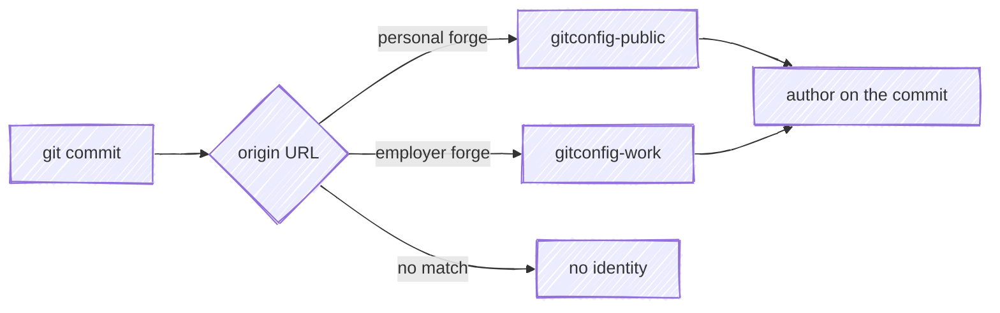

# Multiple Contexts

Git config is per user, but the values you want are often per context: personal
projects and work want different email addresses, sometimes different settings.
`includeIf` picks the right file based on the repository you're in, so it isn't
something you have to remember at commit time.

## Key off the repository

`git` pulls in another config file when a condition holds. The useful condition
here is the repository's own remote URL:

```ini
[user]
	name = Your Name

[includeIf "hasconfig:remote.*.url:git@forge.example.com:*/**"]
	path = ~/.gitconfig-work
```

The address comes from the remote, so it doesn't depend on which terminal you're
in, where you cloned, or a setup step after cloning.



`includeIf` also matches on `gitdir:`, which keys off the checkout's path. That
puts your identity in the filesystem layout, so a repository cloned under the
wrong parent directory commits as the wrong person. The remote URL travels with
the project.

## Shape of the files

| File | Holds |
| --- | --- |
| `~/.gitconfig` | what's shared across contexts: defaults, aliases, and the `includeIf` rules |
| `~/.gitconfig-public` | the identity for personal forges |
| `~/.gitconfig-work` | the identity for an employer's forge |

Each overlay is small, often just an email address, and they all have the same
shape. The shared base stays one file instead of one copy per context.

## Wire both URL shapes

`hasconfig` compares the remote URL as written in the repository, so give each
host both forms, even if you only clone one way today:

```ini
[includeIf "hasconfig:remote.*.url:git@forge.example.com:*/**"]
	path = ~/.gitconfig-work
[includeIf "hasconfig:remote.*.url:https://forge.example.com/**"]
	path = ~/.gitconfig-work
```

With only the ssh pattern in place, a clone of the same repository over https
matches nothing, and one clone you didn't make yourself is enough to hit that.

A `url.insteadOf` rewrite doesn't change which pattern applies. The rewrite
happens when `git` connects, while `.git/config` keeps the URL as typed, so an
https clone stays https as far as `hasconfig` is concerned.

## Fail on no match

A repository that matches no condition, where no email is set globally, still
commits: `git` builds an address from your username and the machine's hostname,
then warns about it afterward. That address can include an internal hostname.

`user.useConfigOnly` limits `git` to what you configured:

```ini
[user]
	useConfigOnly = true
```

An unmatched repository then stops before the commit:

```
Author identity unknown

*** Please tell me who you are.
```

The fix at that point is to add a rule for the host you just hit. A repository
with no remote at all matches nothing either, so a scratch repo from `git init`
needs `git config user.email …` locally before its first commit.

## Check which file won

```bash
git config --show-origin --get user.email
```

The output names the file the value came from. Exit status 1 with no output
means nothing matched.

## Clone and mutate, don't fork

The overlay idea applies to the config repositories themselves. A context that
needs its own identity gets a small repository holding only what's specific to
it, and its setup script clones the shared base and appends to what the base
deploys:

```bash
#! /bin/sh

rm -rf gitconfig
git clone https://forge.example.com/you/gitconfig
cd gitconfig
./update.sh          # deploys the shared base to ~

cat >> ~/.gitconfig << 'EOF'

[includeIf "hasconfig:remote.*.url:git@work.example.com:*/**"]
	path = ~/.gitconfig-work
[includeIf "hasconfig:remote.*.url:https://work.example.com/**"]
	path = ~/.gitconfig-work
EOF

cd ..
cp ./.gitconfig-work ~/.gitconfig-work
```

The clone is thrown away and taken fresh each run, so improvements to the base
reach every context the next time its script runs, and no context carries an
edited copy of the base that has to be reconciled later. The mutation is an
append to the *deployed* file rather than a patch to the checkout, which keeps
the base repository clean enough to publish.

One thing has to go in the base rather than the overlay: anything that must
apply *before* a remote exists. A `url.insteadOf` rewrite is the example, since
`git clone` reads it while the repository it's creating has no remote yet, so no
`hasconfig` condition can match at that moment.

## The general shape

None of this is specific to `git`. Any tool you use across several contexts can
be set up the same way:

- **Publish the base, overlay the differences.** Clone the shared base at setup
  time and append the per-context part; a forked copy of the base drifts.
- **Select on a property of the work.** The repository's remote, the project
  file, the target account: something intrinsic to what you're operating on
  rather than ambient state like the working directory.
- **Give every overlay the same shape,** so adding a context is mechanical.
- **Fail when nothing matches.** A default that's right in one context is wrong
  in the others, so an error beats a guess.
